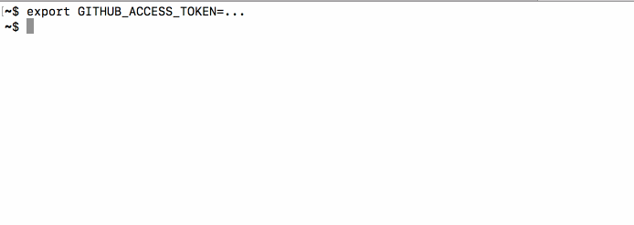

Fue
===

[](https://badge.fury.io/rb/fue) [](https://github.com/dblock/fue/actions/workflows/test.yml) [](https://github.com/dblock/fue/actions/workflows/lint.yml) [](https://github.com/dblock/fue/actions/workflows/package.yml)

Find e-mail addresses of a Github users from their commit logs.

Fue is short for "Finding Unicorn Engineers".

Try [fue-rs](https://github.com/dblock/fue-rs), a faster Rust port of fue with prebuilt binaries for macOS, Linux, and Windows, installed with `brew install dblock/tap/fue`. It searches profiles, recent activity, commit history, and `Signed-off-by` lines in a single `fue <user|owner/repo>` command.



## Table of Contents

- [Usage](#usage)
  - [Commands](#commands)
    - [Find Someone’s Email](#find-someones-email)
    - [Find All Repo Contributors’ Emails](#find-all-repo-contributors-emails)
    - [Find Repo Contributors to Mention](#find-repo-contributors-to-mention)
  - [Options](#options)
    - [Exclude No-Reply Emails](#exclude-no-reply-emails)
    - [Exclude Emails from Signed-off-by](#exclude-emails-from-signed-off-by)
    - [Exclude Names](#exclude-names)
    - [Specify More Depth](#specify-more-depth)
  - [Get Help](#get-help)
  - [Authentication](#authentication)
- [Debugging](#debugging)
- [Contributing](#contributing)
- [Copyright and License](#copyright-and-license)

## Usage

Fue runs on macOS, Linux, and Windows with Ruby 3.0 or newer.

```sh
gem install fue
```

### Commands

#### Find Someone's Email

The `find` command looks through user's initial repository commits. When none of the user's own repositories have their commits, it also looks through their forks.

```sh
$ fue --verbose find defunkt

Chris Wanstrath <chris@ozmm.org>
Chris Wanstrath <chris@github.com>
```

#### Find All Repo Contributors' Emails

The `contributors` command looks through a git log of contributors, then fetches their e-mails.

```sh
$ fue --verbose contributors defunkt/colored

defunkt: Chris Wanstrath <chris@ozmm.org>
kch: Caio Chassot <kch@users.noreply.github.com>
```

#### Find Repo Contributors to Mention

The `mentions` command lists the GitHub `@login` of each repo contributor without an e-mail address other than a `@users.noreply.github.com` one, so you can @mention them instead. Use `--all` to list all contributors. Bots are skipped.

```sh
$ fue mentions dblock/iex-ruby-client

@esarmstrong
@tylerhaugen-stanley-amount
```

### Options

#### Exclude No-Reply Emails

By default `fue find` and `fue contributors` will include no-reply emails such as `kch@users.noreply.github.com` and `noreply@github.com`, which GitHub uses for some commits made on github.com. Exclude those with `--no-noreply`.

```sh
fue find --no-noreply kch
```

```sh
fue --verbose contributors --no-noreply defunkt/colored
```

#### Exclude Emails from Signed-off-by

By default `fue find` and `fue contributors` will include emails gathered from `Signed-off-by` text in commit descriptions. Only sign-offs by the commit author count: those whose name or e-mail address matches the author's name or e-mail address, or the user's GitHub login, ignoring case. Exclude all of them with `--no-signed-off-by`.

```sh
fue find --no-signed-off-by defunkt
```

```sh
fue --verbose contributors --no-signed-off-by defunkt/colored
```

#### Exclude Names

By default `fue find` and `fue contributors` display names with e-mail addresses, such as `Chris Wanstrath <chris@ozmm.org>`. Display only e-mail addresses with `--no-names`.

```sh
fue find --no-names defunkt
```

#### Specify More Depth

By default `fue find` looks at 10 commits in each of the last 100 repositories, which takes 5 requests to GitHub. `fue contributors` and `fue mentions` search each contributor's last 10 repositories, 1 commit each, in 1 request per contributor. You can look at more repositories (breadth) and more commits (depth). Fue pages through larger values of breadth and depth and keeps each request to GitHub small, so any value works and larger values just take longer. For example, `--breadth=1000 --depth=100` searches all of a user's public repositories; for a user with several hundred repositories this takes a couple of minutes and uses a few hundred of the 5,000 points GitHub allows per hour. `fue contributors` and `fue mentions` run such a search for each contributor.

```sh
$ fue find --breadth=100 --depth=5 defunkt

Chris Wanstrath <chris@ozmm.org>
Chris Wanstrath <chris@github.com>
defunkt <chris@ozmm.org>
```

### Get Help

```sh
fue help
```

Displays additional options.

### Authentication

Fue needs a GitHub token and looks for one in this order.

1. The `--token` (`-t`) option or the `GITHUB_ACCESS_TOKEN` environment variable.
2. The [GitHub CLI](https://cli.github.com/), with `gh auth token`. Run `gh auth login` once and fue uses it on macOS, Linux, and Windows without storing a token itself.
3. A token saved in the macOS keychain by fue 0.5.0 and older.

Run with `--verbose` to see which token fue uses. Fue only reads public data, so any token with access to public repositories works, including one created with `public_repo` scope in [GitHub personal access token settings](https://github.com/settings/tokens).

## Debugging

If you run into an unexpected error, try getting a stack trace with `GLI_DEBUG=true`.

```sh
GLI_DEBUG=true fue find dblock
```

## Contributing

There are [a few feature requests and known issues](https://github.com/dblock/fue/issues). Please contribute! See [CONTRIBUTING](CONTRIBUTING.md), [CHANGELOG](CHANGELOG.md), and [RELEASING](RELEASING.md).

## Copyright and License

Copyright (c) 2018-2022, Daniel Doubrovkine, [Artsy](http://artsy.github.io), with help from [Orta](https://github.com/orta).

This project is licensed under the [MIT License](LICENSE.md).
